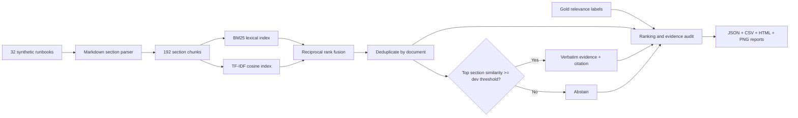
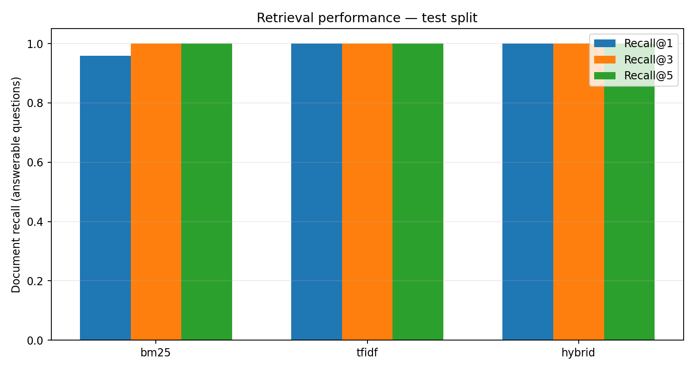
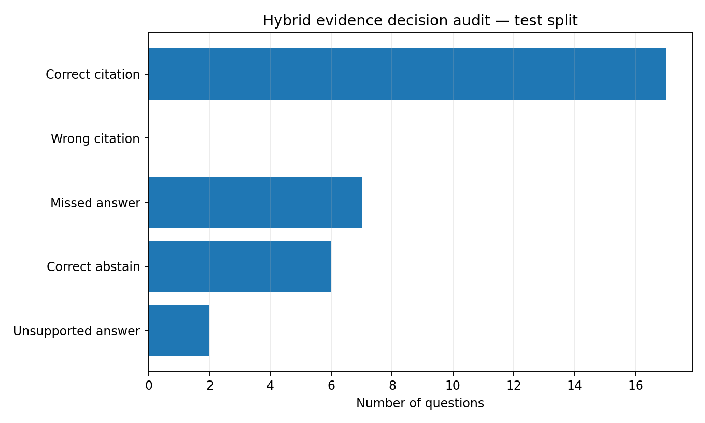

# TraceRAG — Offline Retrieval & Evidence Audit

**A reproducible, API-free RAG retrieval benchmark with citation tracing, development-only abstention tuning, and error analysis.**

[](.github/workflows/ci.yml)


> **Scope:** This project deliberately implements the *retrieval and evidence-selection* stages of a RAG pipeline. It does **not** call an LLM or generate free-form answers. Returned excerpts are verbatim sections from synthetic documents; a citation is a link to a retrieved source, **not proof that the source fully answers the question**.

## Why this exists

A chatbot can produce a fluent answer even when its retrieval layer found the wrong source. TraceRAG makes that failure observable. It benchmarks three offline retrieval strategies, applies an abstention threshold selected on development queries, and audits whether the top cited document matches a gold relevance label. A second challenge set includes unsupported and paraphrased queries.

## Architecture



**Data:** 32 authored, synthetic incident runbooks across gateway, identity, billing, streaming, storage, search, platform, and analytics. Each document contains six sections. The main benchmark has **44 questions** (32 answerable and 12 unsupported): **12 dev** and **32 test**. A separate challenge suite has **20 questions** (12 answerable, 8 unsupported). See [`data/DATASET_CARD.md`](data/DATASET_CARD.md).

## Reproduce in 4 commands

Requires Python 3.10+; no API key, GPU, external dataset, or model download.

```bash
python -m venv .venv
# Linux/macOS: source .venv/bin/activate
# Windows PowerShell: .venv\Scripts\Activate.ps1
python -m pip install -e '.[dev]'
python -m tracerag.cli check-data
python -m tracerag.cli tune
python -m tracerag.cli evaluate --split test --out reports
```

For a second stress evaluation:

```bash
python -m tracerag.cli evaluate --split challenge --out reports/challenge
python -m tracerag.cli ask --query "How should JWKS caches be refreshed after signing key rotation?"
pytest -q
```

**Report:** Open [`reports/index.html`](reports/index.html) locally in a browser. It is a static HTML page, with no server required. Challenge results are in [`reports/challenge/index.html`](reports/challenge/index.html).



## Measured results

Numbers below were produced by `python -m tracerag.cli evaluate --split test` with the development-selected **cosine threshold 0.24**. There are **24 answerable + 8 unsupported** questions in the test set.

| Metric (test) | BM25 | TF-IDF | Hybrid RRF |
|---|---:|---:|---:|
| Document Recall@1 | 0.958 | 1.000 | **1.000** |
| Document Recall@3 | 1.000 | 1.000 | **1.000** |
| MRR@5 | 0.979 | 1.000 | **1.000** |
| Supported response accuracy | 0.719 | 0.719 | **0.719** |
| False-answer rate on unsupported questions | 0.250 | 0.250 | **0.250** |

**Challenge suite (12 answerable + 8 unsupported):** Hybrid Recall@1 = **1.000**, supported response accuracy = **0.800**, and unsupported false-answer rate = **0.250**. Full-precision metrics and individual predictions are stored in `reports/`.

**Interpretation matters:** High retrieval recall on a small, hand-authored corpus does **not** imply that the evidence decision is reliable. On the held-out test set, the system missed 7 answerable questions because the cosine score fell below the threshold, and incorrectly returned evidence for 2 unsupported questions. These are actual measured errors, not hypothetical limitations. A small development set (12 questions) makes the selected threshold unstable.



## How the ranking works

- **BM25:** term-frequency saturation with inverse document frequency and length normalization.
- **TF-IDF:** word unigrams and bigrams, L2 normalization, cosine similarity.
- **Hybrid:** Reciprocal Rank Fusion (RRF) combines both section rankings: `score(d) = 1/(60 + rank_BM25(d)) + 1/(60 + rank_TFIDF(d))` for positive-score candidates.
- **Deduplication:** only the best-ranked section of each runbook is returned, avoiding duplicate documents in top-k.
- **Abstention:** a query is rejected if the top selected section's TF-IDF cosine similarity is below the development-selected threshold. This similarity is **not a calibrated probability**.

**Evaluation protocol:** Threshold is selected only on the development split by maximizing a balanced objective (correct citations for answerable questions and abstentions for unsupported questions). The test and challenge sets are not used to choose the threshold. The same threshold is displayed for all three retrieval modes; it was tuned for hybrid, so evidence-decision comparisons across modes are descriptive rather than independently optimized.

## Failure analysis

| Test query | Observed failure | Why it matters |
|---|---|---|
| `Q006` (JWKS rotation) | Correct document retrieved, but abstained at cosine 0.225 | Ranking quality and decision quality are different |
| `Q026` (HPA oscillation) | Correct document retrieved, but abstained at cosine 0.201 | Keyword variation affects lexical confidence |
| `U002` (DNSSEC key rollover) | Incorrectly cited JWKS document at cosine 0.289 | Shared vocabulary can cause unsupported answers |
| `U003` (push signing key) | Incorrectly cited JWKS document at cosine 0.434 | High similarity does not prove factual support |

See [`docs/ERROR_ANALYSIS.md`](docs/ERROR_ANALYSIS.md) for details and suggested experiments.

## Project layout

```text
tracerag-evidence-lab/
├── .github/workflows/ci.yml        # Python 3.10/3.12 tests and benchmark
├── config/threshold.json           # Frozen dev-only threshold
├── data/
│   ├── runbooks/                  # 32 synthetic Markdown documents
│   ├── evaluation/                # Main and challenge relevance labels
│   └── DATASET_CARD.md
├── src/tracerag/
│   ├── data.py                     # Parsing and validation
│   ├── retrieval.py                # BM25, TF-IDF, RRF, evidence
│   ├── evaluation.py               # Recall, MRR, nDCG, audit, tuning
│   ├── reporting.py                # HTML/PNG/CSV/JSON reports
│   └── cli.py                      # check-data, tune, evaluate, ask
├── tests/                          # Unit and integration tests
├── docs/                           # Error analysis and report previews
├── reports/                        # Reproducible benchmark artifacts
├── scripts/reproduce.sh
├── pyproject.toml
└── LICENSE
```

## Engineering decisions and limitations

1. **No LLM is involved.** This avoids conflating retriever quality with generator quality, but it cannot measure answer faithfulness or hallucinations of generated prose.
2. **Gold labels are document-level**, not section- or span-level. `citation_correct` means the retrieved runbook is relevant, not that the displayed section resolves the question.
3. **The corpus and queries are synthetic**, written for this exercise. They are not representative of real incident reports or production search distributions.
4. **The test set is small and easy for lexical retrieval.** Do not present Recall@1 = 1.0 as a general RAG performance claim.
5. **Abstention is imperfect.** Lexical overlap can produce false evidence even when the topic is unsupported.
6. **No secrets or sensitive data** are included. These runbooks are educational examples, not production instructions or security incident policies.
7. **Not a production service:** no authentication, persistence layer, concurrency guarantees, semantic embedding model, or LLM inference.

## Roadmap

- Add answer-span annotations and section-level citation scoring.
- Add out-of-domain evaluation with a larger and independently curated dataset.
- Compare semantic embedding retrieval and reranking on the same fixed splits.
- Replace fixed similarity threshold with calibrated, per-query evidence support signals.
- Add a small web UI with source navigation and manual relevance feedback.

## License

MIT. The synthetic runbooks and questions were authored for this repository. The dependencies retain their respective upstream licenses. No proprietary operational documentation is included.
